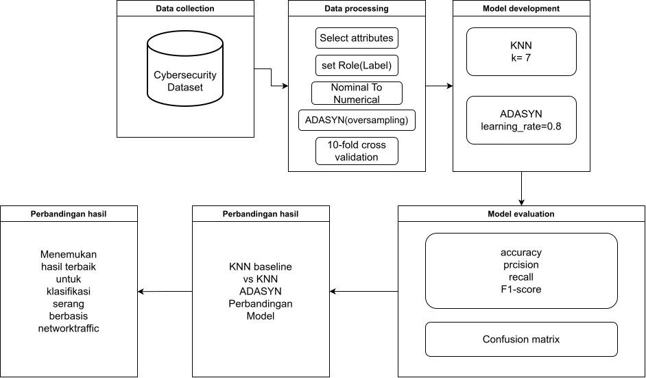

# Deteksi Serangan DDoS Minoritas: KNN Baseline vs KNN + ADASYN

Eksperimen *machine learning* untuk mendeteksi serangan DDoS sebagai **kelas minoritas** pada lalu lintas jaringan. Kode ini membandingkan dua model:

1. **KNN Baseline**: K-Nearest Neighbor tanpa penanganan ketidakseimbangan kelas.
2. **KNN + ADASYN**: KNN yang dilatih pada data latih yang sudah diseimbangkan dengan *Adaptive Synthetic Sampling* (ADASYN).

Tujuannya adalah melihat apakah ADASYN dapat menaikkan **recall** dan **F1-score** kelas DDoS serta menekan **False Negative**, yaitu serangan yang lolos terdeteksi sebagai trafik normal.

> Bagian dari penelitian *"Mendeteksi Serangan Minoritas pada Network Traffic Menggunakan Kombinasi ADASYN dan KNN"*, Teknik Informatika, Sekolah Tinggi Teknologi Bontang.

---

## Daftar Isi

- [Struktur Proyek](#struktur-proyek)
- [Dataset](#dataset)
- [Instalasi](#instalasi)
- [Cara Menjalankan](#cara-menjalankan)
- [Alur Eksperimen](#alur-eksperimen)
- [Fitur yang Digunakan](#fitur-yang-digunakan)
- [Konfigurasi](#konfigurasi)
- [Skema Evaluasi](#skema-evaluasi)
- [Output](#output)
- [Catatan Metodologi](#catatan-metodologi)
- [Tim Peneliti](#tim-peneliti)

---

## Struktur Proyek

```
.
├── KNNADASYN.ipynb             # Notebook utama eksperimen
├── data set pak fiki 1.csv     # Dataset (separator ;)
├── FlowChart.drawio.svg        # Diagram alur penelitian
├── README.md
└── hasil_knn_adasyn/           # Dibuat otomatis saat notebook dijalankan
```

## Dataset

| Keterangan | Nilai |
|---|---|
| Nama file | `data set pak fiki 1.csv` |
| Separator | titik koma (`;`) |
| Kolom target | `label` (0 = Benign, 1 = DDoS/Attack) |
| Kolom pendukung | `attack_type`, `timestamp`, `url`, `user_agent`, `protocol`, `src_port`, `dst_port`, `bytes_sent`, `bytes_received`, `is_internal_traffic` |

Komposisi data menurut catatan di kode:

| Kelas | Jumlah |
|---|---|
| Benign | 1.817 |
| DDoS | 150 |
| Tanpa label | 8.033 (**tidak digunakan**) |

Data tanpa label **tidak dianggap benign** dan dibuang dari eksperimen karena metode yang dipakai adalah *supervised learning*. Baris duplikat juga dihapus.

## Instalasi

Butuh Python 3.9 atau lebih baru dan Jupyter. Pasang library yang diperlukan:

```bash
pip install pandas numpy matplotlib seaborn scikit-learn imbalanced-learn jupyter
```

## Cara Menjalankan

1. Pastikan `data set pak fiki 1.csv` berada di folder yang sama dengan `KNNADASYN.ipynb`.
2. Buka notebook:

```bash
jupyter notebook KNNADASYN.ipynb
```

   Bisa juga dibuka lewat JupyterLab, VS Code, atau Google Colab (unggah dataset ke Colab terlebih dahulu).
3. Jalankan semua sel secara berurutan, misalnya lewat menu **Run → Run All Cells** atau **Kernel → Restart & Run All**.

Hasil tiap tahap dan semua grafik tampil langsung di bawah sel masing-masing. Semua hasil juga disimpan di folder `hasil_knn_adasyn/`.

Untuk menjalankan notebook tanpa membuka antarmuka Jupyter:

```bash
jupyter nbconvert --to notebook --execute KNNADASYN.ipynb --output KNNADASYN_executed.ipynb
```

## Alur Eksperimen



| No | Tahap | Keterangan |
|---|---|---|
| 1 | Membaca dataset | `pd.read_csv(..., sep=";")` |
| 2 | Pemeriksaan data | Info kolom, *missing value*, duplikat |
| 3 | Cleaning | Ambil data berlabel saja, hapus duplikat, ubah label ke integer |
| 4 | Validasi label | *Crosstab* `label` × `attack_type` untuk memastikan kelas 1 adalah DDoS |
| 5 | Feature engineering | Ekstraksi fitur waktu, URL dan *user agent* |
| 6 | Train-test split | 80% latih, 20% uji, `stratify=y` |
| 7 | Preprocessing | Numerik: imputasi median + `StandardScaler`. Kategorikal: imputasi modus + `OneHotEncoder` |
| 8 | KNN Baseline | `KNeighborsClassifier(n_neighbors=7)` |
| 9 | KNN + ADASYN | `ImbPipeline`: preprocessing → ADASYN → KNN |
| 10 | Evaluasi | Accuracy, Precision, Recall, F1, *classification report*, *confusion matrix* |
| 11 | Visualisasi | Pie chart distribusi kelas, grafik perbandingan metrik, *confusion matrix*, *learning curve* |
| 12 | Simpan hasil | Metrik, grafik dan dataset hasil olahan |

## Fitur yang Digunakan

Ada 17 fitur input:

| Kelompok | Fitur |
|---|---|
| Waktu (dari `timestamp`) | `hour`, `minute`, `dayofweek`, `day`, `month` |
| Jaringan | `src_port`, `dst_port`, `bytes_sent`, `bytes_received` |
| URL (dari `url`) | `url_len`, `url_has_query`, `url_path_depth`, `url_has_http` |
| User agent | `ua_len` |
| Kategorikal | `protocol`, `user_agent`, `is_internal_traffic` |

Pemisahan fitur numerik dan kategorikal dilakukan otomatis berdasarkan tipe data kolom (`int64`/`float64` dianggap numerik, `object` dianggap kategorikal).

## Konfigurasi

Semua parameter ada di bagian **2. KONFIGURASI** pada notebook:

| Variabel | Nilai | Fungsi |
|---|---|---|
| `DATASET` | `"data set pak fiki 1.csv"` | Path dataset |
| `RANDOM_STATE_SPLIT` | `42` | *Seed* pembagian data latih/uji |
| `RANDOM_STATE_ADASYN` | `20` | *Seed* ADASYN agar hasil dapat direproduksi |
| `K_NEIGHBORS` | `7` | Jumlah tetangga KNN |
| `OUTPUT_DIR` | `"hasil_knn_adasyn"` | Folder hasil |

Parameter lain: ADASYN memakai `n_neighbors=5`, dan KNN memakai jarak bawaan scikit-learn (Minkowski p=2, yaitu Euclidean).

## Skema Evaluasi

- **Evaluasi utama: hold-out 80:20 dengan stratifikasi.** Kedua model dilatih sekali di data latih dan diuji sekali di data uji yang sama. Semua metrik di tabel perbandingan berasal dari skema ini.
- **Learning curve: 5-fold cross validation** (Stratified K-Fold, otomatis untuk klasifikasi) pada data latih, dengan metrik F1. Hasilnya hanya dipakai untuk kurva dan analisis gap train vs validation, bukan untuk tabel perbandingan.
- Notebook ini **tidak** memakai 10-fold cross validation.

Metrik yang dilaporkan dihitung untuk kelas positif DDoS (`label = 1`):

| Metrik | Rumus | Arti |
|---|---|---|
| Accuracy | (TP + TN) / (TP + TN + FP + FN) | Ketepatan keseluruhan; bisa menyesatkan pada data tidak seimbang |
| Precision | TP / (TP + FP) | Dari yang diprediksi DDoS, berapa yang benar DDoS |
| Recall | TP / (TP + FN) | Dari semua DDoS, berapa yang berhasil terdeteksi |
| F1-score | 2 × (P × R) / (P + R) | Rata-rata harmonis precision dan recall |

## Output

Semua file disimpan di `hasil_knn_adasyn/`:

| File | Isi |
|---|---|
| `hasil_metrik.csv` | Tabel Accuracy, Precision, Recall, F1 kedua model |
| `pie_chart_benign_attack.svg` | Pie chart distribusi Benign vs Attack |
| `perbandingan_metrik.svg` | Grafik batang perbandingan metrik |
| `confusion_matrix_knn_baseline.svg` | Confusion matrix KNN Baseline |
| `confusion_matrix_knn_adasyn.svg` | Confusion matrix KNN + ADASYN |
| `learning_curve_knn_adasyn.svg` | Learning curve F1 kedua model |
| `dataset_cleaned_labeled.csv` | Dataset berlabel setelah cleaning dan feature engineering |
| `dataset_processed_features.csv` | 17 fitur terpilih dan label |

Selain itu, output sel notebook menampilkan distribusi kelas, *classification report*, *confusion matrix* dan analisis gap learning curve.

## Catatan Metodologi

- **Strict data isolation.** ADASYN hanya diterapkan pada data latih. Ini dijamin dengan menaruh ADASYN di dalam `imblearn.pipeline.Pipeline`, sehingga oversampling hanya terjadi saat `fit()` dan tidak pernah menyentuh data uji. Hal yang sama berlaku pada tiap fold learning curve.
- **Preprocessing tanpa kebocoran.** Imputer, scaler dan encoder di-*fit* hanya pada data latih karena berada di dalam pipeline.
- **Accuracy bukan metrik utama.** Pada data yang sangat tidak seimbang, model yang selalu menebak Benign tetap mendapat accuracy tinggi. Karena itu recall dan F1 kelas DDoS menjadi fokus analisis.
- **Trade-off yang wajar.** ADASYN biasanya menaikkan recall DDoS tetapi juga menambah False Positive, sehingga accuracy bisa turun.
- **Reproduksibilitas.** Hasil dapat diulang selama `RANDOM_STATE_SPLIT`, `RANDOM_STATE_ADASYN`, dataset dan versi library sama.

## Tim Peneliti

Teknik Informatika, Sekolah Tinggi Teknologi Bontang

- Ahdam Ashari
- Fiky Anggara
- Ahmad Taroqi A
- Mosyarofah
- Khoirum Nurfatika A
- Gelvi Lopariza L